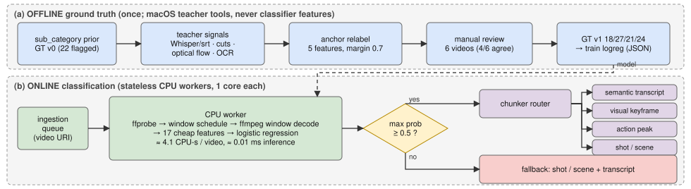

# Video chunking strategy classifier

Predicts, from the raw video alone and on CPU, which chunking strategy to use when indexing it: conversational, info_dense, high_motion or narrative.

## The problem

How a video should be chunked for indexing depends on where its information changes (speech, screen updates, action, cuts), not on its genre. A talking-head esports video needs transcript-based chunking, not action-peak chunking. Each class gets its own downstream treatment:

| Class | Chunking | Captioning | Frames | Indexed |
|---|---|---|---|---|
| conversational | transcript topic/speaker shifts | ASR transcript as caption, sparse visual notes | very low | transcript + speaker turns |
| info_dense | visual state changes | OCR + per-step visual description | on change only | slide/step text + keyframes |
| high_motion | action peaks (motion + audio) | event-level action captions | high during peaks | timestamped events |
| narrative | shot/scene cuts | per-scene captions + dialogue | one or a few per shot | scene descriptions |

## How it works

- **Ground truth:** a genre prior, corrected on ambiguous videos with offline teacher signals and a manual check (GT v1: 18/27/21/24 videos per class). Teacher signals are never used as features. Reports: [step 1](docs/gt_step1_report.md), [step 2](docs/gt_step2_teacher_report.md).
- **Features:** 17 cheap audio, editing/motion and visual-detail features (numpy + OpenCV) from 3 x 30 s windows per video.
- **Model:** logistic regression (3.3 KB), chosen as the simplest model that nothing measurably beat in paired cross-validation.



Full write-up: [docs/writeup.md](docs/writeup.md) (details in [docs/writeup_appendix.md](docs/writeup_appendix.md)).

## Key results

5-fold stratified x 5 repeats on 90 videos (GT v1):

| Model | Acc | Macro-F1 | Unflagged acc |
|---|---|---|---|
| **Logistic regression** | **0.582 ± 0.019** | **0.577 ± 0.017** | **0.641** |
| LightGBM | 0.573 ± 0.036 | 0.583 ± 0.034 | 0.597 |
| Majority class | 0.300 | 0.115 | 0.309 |
| Always shot-detection | 0.267 | 0.105 | 0.191 |

- About 4.1 CPU-s per video on one core (4.7 s for a 54-minute video); about 0.01 ms inference.
- Limitations: only 90 noisy whole-video labels, weak narrative recall, and a fuzzy conversational/info_dense boundary.

## Data

Videos come from the public [Video-MME](https://video-mme.github.io/) benchmark; this project uses a sampled subset (10%, duration-stratified, seed 42) hosted on Hugging Face (source URL in `src/data/download.sh`). Videos are not in the repo (`data/` is gitignored); `bash src/data/download.sh` fetches them (~11.2 GB) for local research use. Committed features, labels and teacher caches let you reproduce results without videos.

## Run it

CPU-only; no videos, GPU or ffmpeg needed for evaluation (same commands as [`run.yaml`](run.yaml)):

```bash
python3 -m venv venv
venv/bin/python -m pip install --upgrade pip
venv/bin/python -m pip install -r requirements.txt
venv/bin/python src/main.py evaluate      # CV results + baselines from committed features
```

Classify one video (needs ffmpeg/ffprobe on PATH): `venv/bin/python src/main.py predict --video path/to/video.mp4` (outputs JSON).

## Tests

```bash
venv/bin/python -m pytest -q   # ~10 s; ffmpeg-dependent tests skip if ffmpeg is absent
```

## Project layout

- `src/`: code ([map](src/README.md))
- `tests/`: unit tests
- `docs/`: write-up, architecture diagram, ground-truth reports
- `gt/`: labels (v0, v1) and teacher signals
- `artifacts/`: features, model, results, and `teacher_cache/` (committed so the ground truth can be reproduced without videos)
- `data/`: videos (gitignored)

## License

Code: MIT (see [LICENSE](LICENSE)). The video data belongs to its original owners and is not covered by this license.
