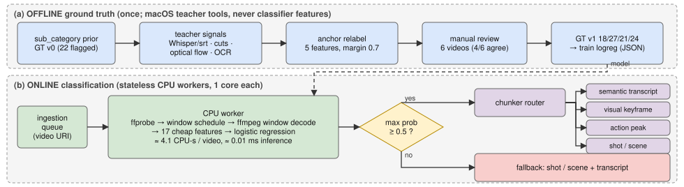

# Choosing a chunking strategy from the raw video

**Thought process.** Chunking depends on *where a video's information changes* (speech, screen updates, action, cuts), so I grouped videos by information structure, not genre. Genre fails: `S8w44Tl5atk` is "Esports" but a talking head, so genre routing would pick action-peak chunking. Without full annotation, I corrected a genre prior on 22 ambiguous videos with offline teacher signals and a manual check. I then measured cheap CPU-only signals against it. I kept the simplest model (logistic regression) and the cheapest budget that nothing measurably beat in paired cross-validation.

## Summary

- **Problem:** from the raw file, on CPU, route a video to one of 4 classes, each with its own downstream treatment (§1).
- **Approach:** genre prior + teacher signals (**never features**) + manual check → GT v1 **18/27/21/24** ([1](gt_step1_report.md), [2](gt_step2_teacher_report.md)); logistic regression on 17 cheap features (numpy + OpenCV) from 3 × 30 s per video.
- **Key result:** **0.582 accuracy / 0.577 macro-F1** (5×5 CV, 90 videos); **0.641** on the 68 teacher-untouched videos. Baselines: majority 0.300, always shot-detection 0.267.
- **Speed:** **≈ 4.1 CPU-s per video** on one core (4.7 s for a 54-min video); 3.3 KB model, ≈ 0.01 ms inference.
- **Main limitation:** 90 noisy whole-video labels; weak narrative recall; fuzzy conversational/info_dense line.

## 1. Classes and downstream treatment

| Class | Chunking | Captioning | Frames | Indexed |
|---|---|---|---|---|
| conversational | transcript topic/speaker shifts | ASR transcript as caption, sparse visual notes | very low | transcript + speaker turns |
| info_dense | visual state changes | OCR + per-step visual description | on change only | slide/step text + keyframes |
| high_motion | action peaks (motion + audio) | event-level action captions | high during peaks | timestamped events |
| narrative | shot/scene cuts | per-scene captions + dialogue | one or a few per shot | scene descriptions |

**Coverage** ([details](writeup_appendix.md#taxonomy-coverage)): podcasts → conversational; sports → high_motion; gameplay → high_motion, or conversational if commentary (`S8w44Tl5atk`). Egocentric/wildlife long-takes fit poorly → proposed "continuous handheld" (embedding-drift) and "static observational" (motion-onset) chunking.

**Evaluation:** primary macro-F1 (imbalanced classes), with accuracy; secondary unflagged-68 score (teacher-untouched labels), confidence vs. coverage; cost CPU-s/video, latency, model size. Rule: cheapest option within noise of the best (paired 5×5 CV).

## 2. Feature engineering ([details](writeup_appendix.md#features))

| Group | Features | Targets |
|---|---|---|
| Audio | `vad_speech_ratio`, `mod4_energy` (syllable rate), `flatness_*`, `rms_db_*`, `silence_frac`, `onset_rate` | speech vs. music; action peaks |
| Editing, motion | `hist_*`, `frame_diff_*`, `static_frac` | narrative cuts; motion vs. static |
| Visual detail | `edge_mean/std` (Canny) | slides/text; textured sports |

## 3. Results (5-fold stratified × 5 repeats on GT v1, mean ± std over repeats)

| Model | Acc | Macro-F1 | Unflagged acc | Merged acc† |
|---|---|---|---|---|
| **Logistic regression** | **0.582 ± 0.019** | **0.577 ± 0.017** | **0.641** | **0.700** |
| LightGBM | 0.573 ± 0.036 | 0.583 ± 0.034 | 0.597 | 0.678 |
| Majority class | 0.300 | 0.115 | 0.309 | 0.500 |
| Always shot-detection | 0.267 | 0.105 | 0.191 | 0.267 |
| *Genre oracle‡* | *0.944* | *0.944* | *1.000* | *0.944* |

† conversational + info_dense merged. ‡ sub_category mapping (metadata): a ceiling.

- **Per-class F1:** motion 0.76, info 0.60, narrative 0.48, conversational 0.47; 13 of 40 errors are conversational↔info_dense. LightGBM: within noise, 2× variance, ~220× size ([coefficients](writeup_appendix.md#scores)).
- **Confidence ≥ 0.7** (46% of videos) gives 0.67 accuracy: a tunable accuracy-vs-coverage threshold ([appendix](writeup_appendix.md#confidence-threshold)).

**Accuracy vs. latency** (same folds, one-core CPU, [sweep](writeup_appendix.md#analysis-budget-sweep)):

| Analysis budget | Macro-F1 | CPU-s/video | 54-min video, wall | Cores, 10,000 h/day |
|---|---|---|---|---|
| 1 × 30 s | 0.488 | 1.5 | 1.8 s | 1.0 |
| **3 × 30 s (shipped)** | **0.577** | **4.1** | **4.7 s** | **2.8** |
| 5 × 60 s | 0.583 | 10.1 | 14.3 s | 6.8 |
| 10 × 60 s (previous) | 0.559 | 16.5 | 30.1 s | 11.1 |

I chose 3 × 30 s, the cheapest budget within noise of the best: no measurable accuracy loss at ~4× less CPU (16.5 → 4.1 CPU-s per video, 11.1 → 2.8 cores for 10,000 h/day). Non-inferiority on 90 videos (folds 12/12), not a gain; selected on the same CV, so slightly optimistic.

## 4. Deployment

- **Throughput:** one core ≈ 880 videos/h (≤ 5 s each); 10,000 h/day ≈ 3 cores (bounds 1–33, [appendix](writeup_appendix.md#capacity-example)). Stateless workers scale on queue depth; the model stores its schedule (predict refuses a mismatch); monitor class-mix, confidence and fallback drift. Encoder keyframes (`ffprobe`, no decode) are near-free **cut candidates** (recall 0.78, precision 0.49).

## 5. Limitations and next steps

[Other experiments](writeup_appendix.md#experiments) (at 10 × 60 s) changed nothing shipped. **Limits:** 90 videos; genre-prior GT (one reviewer); budget/threshold tuned on the same CV; 3 × 30 s can miss modes. **Next:** embeddings; stepwise-change info_dense; full Video-MME; segment routing; QA-outcome GT; keyframe decoding.
