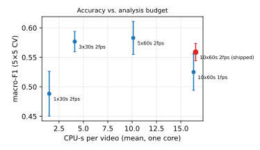

# Appendix (optional detail): features, scores, speed, experiments, reproduction

Supplementary to the 2-page [writeup.md](writeup.md); not needed to follow it.

## Features

All features are computed in `src/features/cheap.py` over its shipped schedule: the whole video if it is 90 s or shorter, otherwise 3 windows of 30 s evenly spaced within 5–95% of the duration, video at 2 fps and 160 px gray. The schedule is stored with the features and in the model, and checked at predict time. Rates are per analysed minute. The class medians below are for the shipped 3 × 30 s features.

| Feature | Computation | Intended signal | Median by class (conv / info / motion / narr) |
|---|---|---|---|
| vad_speech_ratio | share of 1 s blocks with energy > window noise floor + 6 dB and mod4 > 0.6 | speech presence | 0.61 / 0.56 / 0.37 / 0.39 |
| mod4_energy | mean share of 2–8 Hz energy in the 300–3400 Hz log-envelope modulation spectrum (1 s blocks) | syllabic speech vs. music | 0.65 / 0.65 / 0.59 / 0.57 |
| flatness_mean | spectral flatness of active frames | noise-like audio (crowds, wind) | 0.024 / 0.017 / 0.037 / 0.016 |
| flatness_std | std of the above | voiced/unvoiced alternation in speech | |
| rms_db_mean / std / p90 | frame loudness (32 ms frames, 10 ms hop) | level and dynamics | |
| silence_frac | frames < −45 dBFS | quiet tutorials, pauses | |
| onset_rate | ≥ 9 dB loudness rises within 100 ms, per minute | syllable bursts, hits, whistles | 156 / 135 / 48 / 73 |
| hist_delta_mean / p90 | L1/2 distance between 32-bin luma histograms of consecutive 2 fps frames | visual change | 0.079 / 0.101 / 0.126 / 0.114 |
| hist_jump_rate | histogram distance > 0.3, per minute | cuts | 6.7 / 10.0 / 15.3 / 14.9 |
| frame_diff_mean / p90 | mean abs luma difference / 255 | motion | p90: 0.14 / 0.17 / 0.19 / 0.20 |
| static_frac | frames with diff < 0.01 | static slides, talking heads | 0.30 / 0.16 / 0.00 / 0.14 |
| edge_mean / std | Canny(100, 200) pixel density | text and slides, textured scenes | 0.123 / 0.096 / 0.140 / 0.099 |

## Scores

Shipped 3 × 30 s features. Per-class F1, mean over 5 repeats:

| Model | conv | info | motion | narr |
|---|---|---|---|---|
| Logistic regression | 0.468 | 0.597 | 0.759 | 0.484 |
| LightGBM | 0.591 | 0.485 | 0.752 | 0.505 |
| Sub_category oracle | 0.944 | 0.946 | 0.954 | 0.933 |

Logistic regression confusion matrix (repeat 0; rows = true, columns = predicted; order conv, info, motion, narr):

```
conv   [ 8,  6,  1,  3]
info   [ 7, 14,  0,  6]
motion [ 2,  1, 16,  2]
narr   [ 3,  4,  5, 12]
```

Top logistic regression coefficients (standardized features):

| Class | Top features |
|---|---|
| conversational | edge_std +0.61, static_frac +0.57, flatness_mean −0.52 |
| info_dense | static_frac +0.90, mod4_energy +0.76, hist_delta_mean +0.56 |
| high_motion | flatness_mean +1.08, static_frac −1.00, edge_mean +0.90 |
| narrative | mod4_energy −0.79, hist_delta_mean −0.77, edge_mean −0.75 |

Machine-readable outputs in `artifacts/results/`, by the script that writes them:

| Script | Files |
|---|---|
| `src/main.py evaluate` (`src/classify/evaluate.py`) | cv_summary.csv, oof_predictions_repeat0.csv, confusion_repeat0.json, feature_importance.csv, analyses.json, inference_latency.json |
| `src/experiments/budget_sweep.py` | budget_sweep.csv, model_size_speed.json |
| `src/features/cheap_v2.py` | keyframe_vs_cuts.csv |
| `src/experiments/ablation_v2.py` | ablation_v2*.csv |
| `src/experiments/downstream_validity.py` | downstream_validity*.csv |

## Speed

Measured on an Apple M1 Pro, one core (`CHEAP_FFMPEG_THREADS=1`, BLAS/OpenCV threads = 1). CPU time includes the ffmpeg child processes. The full per-budget numbers are in [Analysis-budget sweep](#analysis-budget-sweep).

**Shipped 3 × 30 s budget:**

| Measure | Value |
|---|---|
| CPU-s per video, mean | 4.1 |
| CPU-s per video, p95 | 6.5 |
| CPU-s per hour of source video | 14.3 |
| CPU-s per analysed minute | 2.9 |
| 54-min 720p video, wall time | 4.7 s |
| Share of source time analysed | 8.3% |
| Inference (JSON model) | ≈ 0.01 ms |

- **Previous 10 × 60 s budget:** 16.5 CPU-s per video, 30.1 s wall for the same video, and 37% of source time analysed.
- **Teacher pipeline, for comparison:** about 5.6 s per analysed minute of mostly accelerator-bound work, macOS only.

## Reproduce

```bash
# graded path (no videos)
python3 -m venv venv && venv/bin/python -m pip install -r requirements.txt
venv/bin/python src/main.py evaluate
# one video (needs ffmpeg/ffprobe on PATH)
venv/bin/python src/main.py predict --video data/videos/<id>.mp4
# data + features from scratch (~11.2 GB download, local research use only)
bash src/data/download.sh && python src/data/probe.py && python src/gt/step1_map.py
venv/bin/python src/features/cheap.py --jobs 4      # shipped 3 x 30 s schedule (+ .meta.json)
venv/bin/python src/main.py evaluate                  # retrain; model JSON stores the schedule
# analysis-budget sweep (experiment env: requirements-experiments.txt)
CHEAP_FFMPEG_THREADS=1 python src/experiments/budget_sweep.py extract && python src/experiments/budget_sweep.py evaluate
# teacher / GT v1 (macOS, Apple Silicon): see gt_step2_teacher_report.md
```

## Confidence threshold

Logistic regression, out-of-fold, pooled over 5 repeats:

| Max probability | Share of videos | Accuracy | If the threshold is set here |
|---|---|---|---|
| < 0.5 | 19% | 0.50 | **0.5 (shipped):** 81% decided |
| 0.5–0.7 | 35% | 0.52 | |
| ≥ 0.7 | 46% | 0.67 | **0.7:** 46% decided at 0.67 accuracy, 54% go to fallback |

Choose the threshold from the relative cost of a wrong specialized chunker versus the generic fallback (shot detection + transcript), and recalibrate it on more data. With 90 videos, the 0.5–0.7 band is barely better than the band below it.

## Capacity example

10,000 h of new video per day at the shipped 3 × 30 s budget, using measured one-core CPU.

- **Measured cost:** 14.3 CPU-s per hour of source video, from 4.1 CPU-s per video over 25.88 h of video. That's because only 8.3% of source time is analysed, at about 2.9 CPU-s per analysed minute.
- **CPU:** 10,000 h × 14.3 = 143,000 CPU-s/day ÷ 86,400 s = **1.65 cores busy around the clock**.
- **At 60% target utilization**, with headroom for peaks: 1.65 / 0.6 ≈ **2.8 cores**.
- **Upper bound,** every video ≤ 90 s (everything analysed): 600,000 min × 2.9 / 86,400 = 19.9 busy → **33 cores** at 60%.
- **Lower bound,** every video 1 h (1.5 min analysed each): 10,000 × 1.5 × 2.9 / 86,400 = 0.5 busy → **1 core** at 60%.
- **Overhead:** per-video overhead (ffprobe, process start) is under 0.5 s and is ignored here.
- **Previous budget:** at 10 × 60 s, the same arithmetic with measured CPU gives 11.1 cores. The earlier write-up's 13 cores used a conservative 3.0 CPU-s/min planning figure.

## Analysis-budget sweep

`src/experiments/budget_sweep.py` re-extracts the same 17 features with only the window schedule and fps changed, then scores logistic regression on the **same 5×5 folds**. Windows are evenly spaced in 5–95% (a single window is centred), and a video no longer than the budget is analysed whole. The re-extracted 10 × 60 s at 2 fps features reproduce the previous v1 features exactly (1,530 / 1,530 values), and give 0.564 / 0.559.

| Budget | Acc | Macro-F1 | Unflagged acc | CPU-s/video (mean / p95) | 54-min video, 1-core wall | CPU-s per video-hour | Cores, 10,000 h/day | ΔF1 vs 10 × 60 s | Folds +/− |
|---|---|---|---|---|---|---|---|---|---|
| 1 × 30 s | 0.487 | 0.488 | 0.544 | 1.5 / 2.3 | 1.8 s | 5.2 | 1.0 | −0.070 | 7/18 |
| **3 × 30 s (shipped)** | **0.582** | **0.577** | **0.641** | **4.1 / 6.5** | **4.7 s** | **14.3** | **2.8** | +0.018 | 12/12 |
| 5 × 60 s | 0.587 | 0.583 | 0.659 | 10.1 / 19.6 | 14.3 s | 35.2 | 6.8 | +0.024 | 14/10 |
| 10 × 60 s at 1 fps | 0.529 | 0.525 | 0.574 | 16.3 / 37.9 | 31.5 s | 56.7 | 10.9 | −0.034 | 9/16 |
| 10 × 60 s at 2 fps (previous) | 0.564 | 0.559 | 0.626 | 16.5 / 38.0 | 30.1 s | 57.5 | 11.1 | 0 | |



**Findings:**
- **Halving the fps saves almost no CPU** (16.3 vs 16.5), because ffmpeg decodes every frame before the fps filter drops any. It also costs accuracy.
- **One 30 s window is too little** (−0.070).
- **3 × 30 s and 5 × 60 s are within noise** of 10 × 60 s. The standard deviation of the per-repeat ΔF1 is about 0.03.
- **I chose 3 × 30 s,** the cheapest budget within noise, as **non-inferiority, not a gain**. It was selected on the same CV, so its score is slightly optimistic.

## Model size and speed

| Model | On disk | Inference per video |
|---|---|---|
| **Logistic regression (JSON, shipped)** | **3.3 KB** | **≈ 0.01 ms** |
| LightGBM (text model) | 721 KB (723 KB pickled) | ≈ 0.25 ms |

**How latency is measured:** `evaluate` times single-row `predict_proba` over 20 × 90 calls in one process, with features precomputed, and writes `artifacts/results/inference_latency.json`. The JSON model is timed exactly as `predict` runs it. Repeated runs vary by roughly ±40% (0.006–0.010 ms), hence "≈ 0.01 ms". Feature extraction (about 4 s) dominates either way. The sizes come from `artifacts/results/model_size_speed.json` (written by `budget_sweep.py`), whose latencies are an earlier run of the same measurement.

At the shipped budget, LightGBM's macro-F1 (0.583 ± 0.034) is within noise of logistic regression's (0.577 ± 0.017). It has about twice the variance, is about 220× larger and about 25× slower, so logistic regression is shipped.

## Taxonomy coverage

How the task's example video types map onto the 4 classes:

| Video type | Class | Note |
|---|---|---|
| Podcasts, interviews, lectures | conversational | information is in the speech; transcript chunking |
| Slides, tutorials, screen recordings | info_dense | stepwise visual state changes |
| Sports | high_motion | action peaks; commentary is secondary |
| Gameplay | high_motion, or conversational for commentary/face-cam streams | `S8w44Tl5atk` ("Esports") is a talking head, so the signals route it to conversational |
| Films, TV, ads, stage | narrative | edited cuts carry structure |
| Egocentric (head-cam, vlogs while walking) | fits poorly | no cuts, constant camera motion, sparse speech; proposed class **"continuous handheld"** with embedding-drift chunking |
| Wildlife and surveillance long-takes | fits poorly | static camera, rare events; proposed class **"static observational"** with motion-onset event chunking |

Neither proposed class has enough examples in this 90-video sample to train or evaluate. Today they would be classified as high_motion or narrative, or fall back on low confidence.

## Experiments

These experiments ran at the **previous 10 × 60 s budget**. Their conclusions are relative comparisons at that budget.

**Summary** (moved from the main write-up):
- **Downstream chunk check (negative):** length sanity can't validate chunkers (only degeneracies hold). The real test is QA/retrieval outcomes.
- **Feature groups v2 (at 10 × 60 s):** none robustly beats v1. Color is +0.031, at the noise edge; all groups are +0.044 but fold-unstable, at 3.5× the CPU. So I kept v1.
- **Teacher features as a classifier** score lower (0.49 vs 0.56 macro-F1), possibly because genre-derived labels favour genre-correlated cues.

### 1. Downstream chunk check (negative result)

`src/experiments/downstream_validity.py` uses the teacher cache only. It simulates the 4 chunkers:
- **shot:** cuts
- **transcript:** pauses > 1.5 s; no text or cue ids are available
- **action-peak:** motion maxima above the video's p80, ≥ 5 s apart
- **keyframe:** OCR text change

A chunk is "sane" if 5–120 s long. The primary table uses only the 48 videos analysed whole (≤ 600 s), where chunk lengths are true lengths. Outputs: `artifacts/results/downstream_validity*.csv`.

Sane coverage (share of time in 5–120 s chunks); bold = the class's own chunker:

| GT v1 class (n) | transcript | keyframe | action_peak | shot |
|---|---|---|---|---|
| conversational (7) | **0.72** | 0.52 | 0.98 | 0.63 |
| info_dense (18) | 0.80 | **0.49** | 0.98 | 0.64 |
| high_motion (9) | 1.00 | 0.28 | **0.97** | 0.68 |
| narrative (14) | 0.92 | 0.55 | 0.98 | **0.33** |

The own chunker is not best for any class. **The metric is the cause, not necessarily the classes:**
1. Action-peak uses a per-video relative threshold and a minimum gap, so it yields "sane" lengths on any content.
2. Pause-based transcript splitting fails exactly on continuous-speech conversational videos (71% have no boundary at all). A real transcript chunker splits on sentences and topics.
3. Shot splitting at every cut fragments narrative (54% of chunks < 2 s, 25 chunks/min). A real scene chunker groups shots.

**Degeneracies that do hold:**
- The shot chunker on conversational: 14% of videos have no cut, and 11% of time is in > 120 s chunks.
- The keyframe chunker on narrative: 15% of time is in > 120 s chunks, and across all 90 videos 27% of windows have no text change.

The proper validation is outcome-based: which chunker gives the best retrieval/QA on each video's questions.

### 2. Feature groups v2 (experiment only; not shipped)

`src/features/cheap_v2.py` (needs `requirements-experiments.txt`: OpenCV 4.12 for Haar, numpy < 2.3) → `artifacts/features/cheap_features_v2.csv`. `src/experiments/ablation_v2.py` → `artifacts/results/ablation_v2*.csv`.

The groups are:
- **A, bitstream:** `ffprobe` packets, no decode
- **B, faces:** Haar, 1 fps, 320 px
- **C, color/light:** 2 fps, 160 px BGR
- **D, shot rhythm:** from the v1 jump detector
- **E, audio+:** ZCR, centroid, low-energy, 13 MFCCs

Scoring is logistic regression with the shipped settings, on the **same 5×5 folds** as v1. The comparison is paired, and |Δ| < 0.03 counts as noise.

| Feature set | n | Acc | Macro-F1 | conv | info | motion | narr | Unflagged acc | Extra CPU-s/min | ΔF1 | Folds +/− |
|---|---|---|---|---|---|---|---|---|---|---|---|
| **v1 (10 × 60 s)** | 17 | 0.564 | 0.559 | 0.508 | 0.571 | 0.704 | 0.452 | 0.626 | 0 | 0 | |
| +A bitstream | 25 | 0.524 | 0.527 | 0.509 | 0.488 | 0.708 | 0.405 | 0.574 | 0.02 | −0.031 | 10/15 |
| +B faces | 19 | 0.567 | 0.563 | 0.564 | 0.560 | 0.695 | 0.433 | 0.626 | 3.42 | +0.004 | 11/8 |
| +C color | 22 | 0.589 | 0.590 | 0.551 | 0.574 | 0.741 | 0.492 | 0.659 | ≤ 2.71* | +0.031 | 14/11 |
| +D rhythm | 20 | 0.544 | 0.538 | 0.451 | 0.572 | 0.685 | 0.447 | 0.594 | 0.02 | −0.020 | 9/13 |
| +E audio+ | 35 | 0.551 | 0.558 | 0.512 | 0.485 | 0.755 | 0.479 | 0.597 | 0.24 | −0.001 | 12/13 |
| +all | 53 | 0.596 | 0.603 | 0.547 | 0.548 | 0.821 | 0.495 | 0.644 | 6.40 | +0.044 | 13/12 |
| +best (B, C)† | 24 | 0.576 | 0.576 | 0.539 | 0.550 | 0.738 | 0.478 | 0.647 | 6.13 | +0.017 | 14/11 |

\* Upper bound: one color decode could replace v1's gray decode. † Groups selected on the same CV, so this row is optimistic.

**Gain per extra CPU-s/min:**

| Group | Gain per CPU-s/min | Note |
|---|---|---|
| C | +0.011 | |
| all | +0.007 | |
| B | +0.001 | |
| A, D, E | none | no gain |

**Decision: keep v1.** C's gain sits at the noise threshold, with an unstable fold split. All groups together gain on average, but they're unstable across folds, cost 3.5× the CPU, and need OpenCV 4.12 (Haar was removed in OpenCV 5). Neither justifies re-extraction plus the extra cost and dependency change. B's only notable effect is conversational F1 rising from 0.51 to 0.56, which is plausible (talking heads) but within noise.

**Encoder keyframes vs teacher cuts** (±0.5 s, all 90 videos; `artifacts/results/keyframe_vs_cuts.csv`):

| Class | Precision | Recall |
|---|---|---|
| conversational | 0.44 ± 0.32 | 0.74 ± 0.21 |
| info_dense | 0.45 ± 0.31 | 0.73 ± 0.21 |
| high_motion | 0.43 ± 0.25 | 0.81 ± 0.14 |
| narrative | 0.63 ± 0.29 | 0.84 ± 0.16 |
| **all** | **0.49 ± 0.30** | **0.78 ± 0.19** |

Encoders also place keyframes at fixed GOP intervals, so keyframes are **not a cut detector**. They are a near-free **cut-candidate generator**: 0.02 CPU-s/min, no decoding. A shot chunker can decode only around the candidates to confirm them.

### 3. Teacher features as a classifier

| Model (same folds) | Acc | Macro-F1 | info F1 | narr F1 | Unflagged acc |
|---|---|---|---|---|---|
| Cheap v1, logistic regression | 0.564 | 0.559 | 0.571 | 0.452 | 0.626 |
| Teacher 5, logistic regression | 0.500 | 0.494 | 0.272 | 0.634 | 0.512 |
| Teacher 5, nearest anchor (fit on training folds only) | 0.453 | 0.444 | 0.183 | 0.620 | 0.450 |

The teacher features are speech coverage, cuts/min, global and residual motion, and central text area. The cheap features match or exceed them on these labels, even though the teacher pipeline costs about 5.6 CPU-s/min on macOS-only tools, against 2.5 for the cheap features. Most labels are still genre-derived, so part of the cheap model's edge may come from genre-correlated cues (loudness, spectral shape). The teacher features are stronger on narrative (real cut counts) and weak on info_dense. Cleaner, structure-based labels would make this comparison more meaningful.
